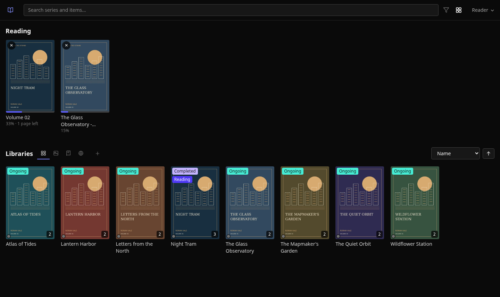
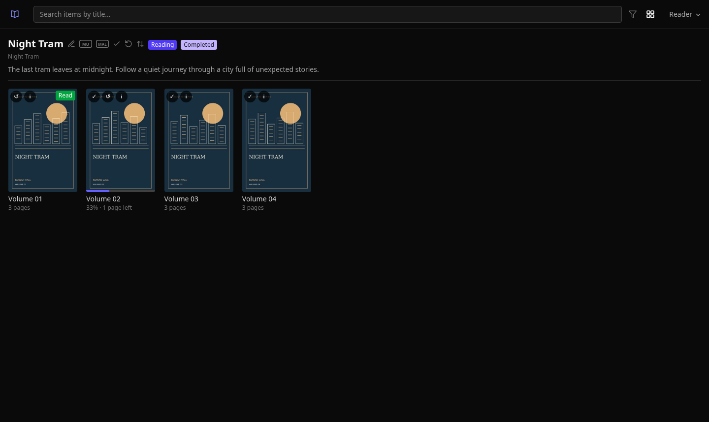
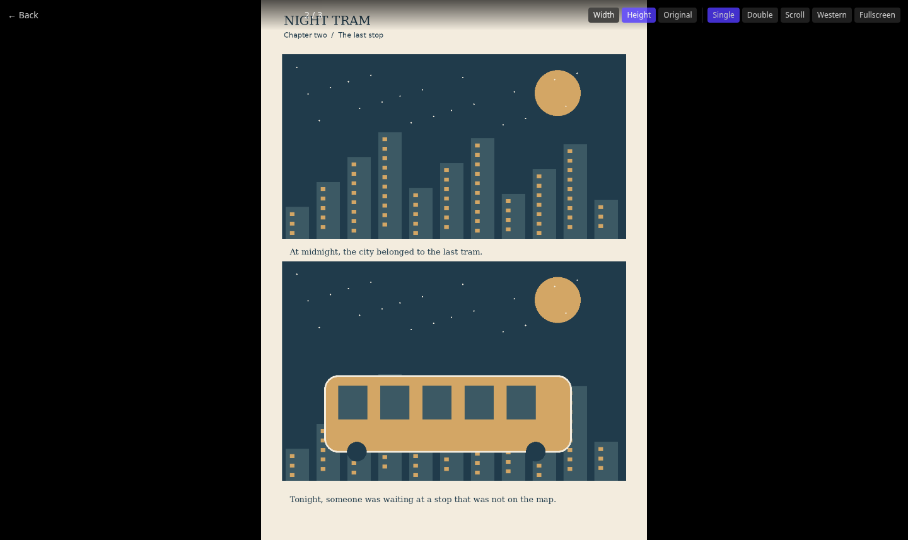
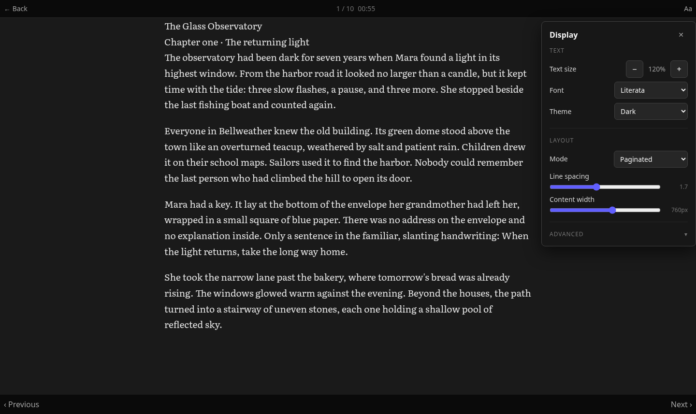

# Publication Reader

A self-hosted library for manga, comics, EPUBs and web novels. Organize your
collection, read in your browser and pick up where you left off on another
device. Designed for one reader, with password, TOTP and passkey sign-in.



*Real application screens with fictional books and original sample artwork.*

[Install](#install-with-docker) · [Choose a version](#choose-a-version) ·
[Update and back up](#update-and-back-up) · [Screenshots](#screenshots) ·
[Development](#development)

## Install with Docker

Requires Docker Engine with Compose and a `linux/amd64` host. ARM images are
not currently published. Your EPUB/CBZ files remain on the host, mounted
read-only; the database, covers and downloaded web novels live in `./data`.

```bash
git clone https://github.com/xxshade/weebreader.git
cd weebreader
cp .env.example .env
```

Edit `.env`, setting your library's absolute path and the address you will
use to open the application. For access on the Docker host itself:

```dotenv
LIBRARY_PATH=/absolute/path/to/your/books
APP_WEBAUTHN_RP_ID=localhost
APP_WEBAUTHN_ORIGIN=http://localhost:8000
PUBLICATION_READER_IMAGE=ghcr.io/xxshade/weebreader:latest
```

The supplied Compose file does **not** publish a host port or configure a
reverse proxy. For localhost access, create `docker-compose.override.yml`:

```yaml
services:
  app:
    ports:
      - "127.0.0.1:8000:8000"
```

```bash
docker compose pull
docker compose up -d
```

Open <http://localhost:8000/setup> and create your account. In the library,
add a folder under `/media/library`, the container path for `LIBRARY_PATH`.
Separate folders can be added as manga/comic and ebook libraries.
Complete this initial account setup before allowing public network access to
your installation.

For access through your domain, set `APP_WEBAUTHN_RP_ID` to the hostname
(without a scheme or port) and `APP_WEBAUTHN_ORIGIN` to the exact HTTPS
origin. Point your reverse proxy at the localhost port above, or attach the
proxy and app to a shared Docker network and use `app:8000`. Supply your own
TLS/proxy configuration; Caddy and a VPN are optional deployment choices.
Passkeys require HTTPS, except for the browser's localhost allowance.

MyAnimeList is optional. Register your own application at
<https://myanimelist.net/apiconfig>, set `APP_MYANIMELIST_CLIENT_ID` and
`APP_MYANIMELIST_REDIRECT_URI` in `.env`, and recreate the container. The redirect
URI must exactly match your registration. Supply `APP_MYANIMELIST_CLIENT_SECRET`
if that registration requires one; see `.env.example`. No shared client ID or
callback domain is bundled. Restored linked accounts need their original client
registration configured for token refresh; reconnect if you change registration.

If your GHCR package is private, authenticate before pulling with an account
that can read it; registry access follows the package's visibility settings.

## Choose a version

| Image reference | Behavior |
| --- | --- |
| `ghcr.io/xxshade/weebreader:latest` | The latest successfully published stable release, with the same digest as its numbered tag. |
| `ghcr.io/xxshade/weebreader:8.3.6` | An exact stable release; the release workflow refuses to overwrite it. |
| `ghcr.io/xxshade/weebreader:<full-commit>` | An alias of the image released from that exact source commit. |
| `ghcr.io/xxshade/weebreader@sha256:…` | The exact image digest provided in a Release. |

Find available versions and their notes in [Releases](https://github.com/xxshade/weebreader/releases).
The first stable release is planned as `v8.3.6`, published manually through
the Release workflow. Subsequent eligible merges publish new versions
automatically. Backend checks and both desktop browser targets (Chrome and
Firefox, including mobile viewport simulations) must be validated locally.
Documentation, tests and CI changes alone do not create releases. No moving major/minor
aliases are published.

To pin a published version, change one line in `.env` and recreate the app:

```dotenv
PUBLICATION_READER_IMAGE=ghcr.io/xxshade/weebreader:8.3.6
```

```bash
docker compose pull
docker compose up -d
```

You can use the full digest reference from the Release in the same variable.
Version numbers follow SemVer: **patch** for fixes, **minor** for compatible
features, **major** for incompatible changes. Git tags have a `v` prefix
(`v8.3.6`); container tags do not (`:8.3.6`).

## Update and back up

Read the target Release's migration notes before upgrading. Database
migrations run automatically when the application starts.

For the supplied Compose configuration, stop writes and back up the complete
data directory together with your current configuration:

```bash
docker compose stop app
backup_dir="backups/$(date +%Y%m%d-%H%M%S)"
mkdir -p "$backup_dir"
tar -czf "$backup_dir/data.tar.gz" data
cp .env docker-compose.yml "$backup_dir/"
if [ -f docker-compose.override.yml ]; then
  cp docker-compose.override.yml "$backup_dir/"
fi
docker image inspect --format '{{json .RepoDigests}}' "$(docker compose images -q app)" > "$backup_dir/image-digests.json"
docker compose start app
```

Keep the backup and configuration private, and retain a copy on another
disk. The data directory includes credentials and reading history; library
files under `LIBRARY_PATH` need their own backup.

Select the target image in `.env`, then run `docker compose pull` and
`docker compose up -d`. Check startup with `docker compose logs --tail=100 app`.
When upgrading from `latest`, keep the recorded image digest so a rollback
can select the original build. A library path that cannot be watched intentionally stops startup; check
that your library mount is available before restarting.

**Rollback requires a matching data backup.** Pinning an older image alone
may not work after a database migration. Stop the app, preserve the current
data separately, restore the backup into `./data`, restore the previous
configuration/image reference, and start the app again. Restoring an older
backup also restores its older reading progress and downloaded content.

## Features

- **EPUB and CBZ libraries:** series organization, live folder watching,
  manual ordering and an issues page for incomplete or unreadable files.
  Comics must be real ZIP archives; RAR/CBR is not supported.
- **Home filters:** “Unread only” shows works with unfinished items or chapters,
  including reading in progress. The choice is saved in this browser and paused
  while searching. Cards update as reading progress changes.
- **Comic reader:** single or double pages, manga/western reading direction,
  vertical and horizontal scrolling, and fullscreen.
- **Text reader:** paginated or continuous reading for EPUBs and web novels,
  font/theme controls and saved reading positions.
- **Web novels:** download chapters from supported sources and synchronize
  them on a schedule.
- **Tracking:** link series to MangaUpdates or MyAnimeList and synchronize
  reading status and progress. MyAnimeList needs your OAuth configuration
  from `.env.example` and an exactly matching registered redirect URI.
- **Reading statistics:** time spent reading, daily activity, estimated words
  per minute for EPUBs and web novels, and separate comic page visits. Existing
  remaining-time estimates remain available. See [how measurements work](docs/reading-statistics.md).
- **Authentication:** password hashing with Argon2id, TOTP and WebAuthn
  passkeys.

## Screenshots

| Series and volumes | Comic reader |
| --- | --- |
|  |  |



The shared text reader also serves web novels. All pictured titles, text,
artwork and reading history are demo data. See [how to reproduce the captures](docs/screenshots.md).
The pictured flows are exercised in **Chrome and Firefox**.

## Development

Use Python 3.14 to match the Docker image and CI. Frontend assets are committed
static files: no npm, bundler or CSS build is needed.

```bash
python3.14 -m venv .venv
./.venv/bin/pip install -r requirements.txt
export APP_DATA_DIR="$PWD/data"
export APP_WEBAUTHN_RP_ID=localhost
export APP_WEBAUTHN_ORIGIN=http://localhost:8000
./.venv/bin/python -m uvicorn app.main:app --reload --port 8000
```

Open <http://localhost:8000/setup> to create a development account. Local
web-novel scraping also needs Chrome/Chromium and a matching driver; set
`APP_NOVEL_CHROMIUM_BINARY_PATH` and `APP_NOVEL_CHROMEDRIVER_PATH` if they are
not discoverable on `PATH`.

For a local Docker build, set `PUBLICATION_READER_IMAGE=publication-reader:dev`
in `.env` and run `docker build -t publication-reader:dev .`, then
`docker compose up -d`.

### Tests

Tests use the standard library's `unittest` runner plus the installed
application dependencies. They create temporary databases and media; no
existing development server or library is required.

```bash
./.venv/bin/pip install pyflakes requests soft-webauthn
APP_DATA_DIR=/tmp/publication-reader-tests ./.venv/bin/python -m scripts.test_backend
./.venv/bin/pyflakes app scripts
find app/static -name '*.js' -print0 | xargs -0 -n1 node --check
./.venv/bin/python scripts/test_webauthn_isolated.py
```

Run all browser suites with installed browser binaries and matching drivers:

```bash
./.venv/bin/python scripts/test_resync_browser.py \
  --chrome-binary /path/to/chrome --chromedriver /path/to/chromedriver \
  --firefox-binary /path/to/firefox --geckodriver /path/to/geckodriver
./.venv/bin/python scripts/test_audit_browser.py \
  --chrome-binary /path/to/chrome --chromedriver /path/to/chromedriver \
  --firefox-binary /path/to/firefox --geckodriver /path/to/geckodriver
./.venv/bin/python scripts/test_cache_browser.py \
  --chrome-binary /path/to/chrome --chromedriver /path/to/chromedriver \
  --firefox-binary /path/to/firefox --geckodriver /path/to/geckodriver
```

The backend runner fails on unexpected `RuntimeWarning`/`ResourceWarning`
diagnostics, unraisable exceptions and background errors, even when individual
tests report `OK`.

**Chrome and Firefox desktop must both pass**, including the mobile viewport
scenarios, using the current stable versions selected at local validation start.
Missing or skipped desktop targets leave local validation incomplete. Native Android testing
is deferred; its scripts and [setup notes](docs/testing/android.md) are retained
for future work. Mobile viewport simulations do not run an Android browser.
The desktop suites start disposable
servers, keep the HTTP cache enabled, and exercise reconnection, real server
restarts, retained disk cache after browser restart, image preservation,
navigation and the readers. `immutable` permits reuse while an image remains
cached; browsers can still evict it when their cache fills.

Run validation locally before merging and record the results in the PR.
GitHub Actions runs only release/package publication on pushes to `main`
(including direct pushes), plus manual recovery. It does not run PR or
post-merge tests or PR-only Docker builds. The publisher checks release metadata
and image identity; it does not enforce test results. Remove retired required
status checks from branch protection/rulesets if they were configured.
Browser commands run both engines by default; see
[browser validation](docs/testing/browser-checks.md) for the suites, target
selection and isolation of deliberate-defect controls.

For the release procedure and partial-failure recovery, see
[Publishing a release](docs/releases.md). Architecture and contribution
invariants live in [AGENTS.md](AGENTS.md).
